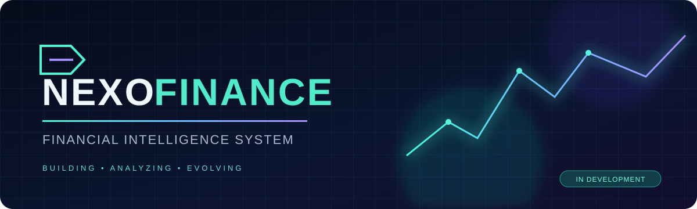

### Gestão financeira empresarial, do dado à decisão

**Visibilidade pública do projeto · Código operacional privado · Sem dados financeiros reais**

---

## ◈ Visão do projeto

O **Nexo Finance** é um sistema de gestão e conciliação financeira empresarial em desenvolvimento. Seu objetivo é centralizar vendas, movimentações bancárias, recebíveis, despesas e fechamentos, reduzindo retrabalho e melhorando a rastreabilidade das análises.

O projeto integra necessidades reais de gestão a práticas de **Engenharia de Software**. Este repositório é uma **vitrine técnica e documental**, não o código-fonte de produção.

## ◈ Arquitetura funcional

| Módulo | Propósito |
|:--|:--|
| **Overview** | Indicadores e acompanhamento financeiro |
| **Sales** | Totais de vendas e consultas por período |
| **Banking** | Saldos por conta e movimentações importadas |
| **Reconciliation** | Conferência de saldos e análise de divergências |
| **Receivables** | Acompanhamento de recebíveis de cartões |
| **Cash Vault** | Movimentações de dinheiro em espécie |
| **Reports** | Fechamentos semanais e mensais |
| **Settings** | Administração, preferências e controles de acesso |

> A presença de um módulo na documentação não certifica que todas as suas funcionalidades estejam concluídas ou validadas em produção.

## ◈ Stack identificada nas prévias

  
  
  
  

## ◈ Próxima etapa: conciliação progressiva

A conciliação foi especificada para trabalhar a partir de um **Dia Zero definido pelo usuário** — um saldo de abertura com data e horário por conta, sem necessidade de recuperar lançamentos antigos.

- **Progressiva e não bloqueante:** cada verificação acontece quando os dados relevantes daquela verificação estiverem disponíveis.
- **OFX:** entradas e saídas registradas no saldo bancário, com proteção planejada contra duplicidades.
- **PIX:** créditos entram na movimentação, sem classificação automática como vendas e sem exigir venda individual correspondente.
- **Outras receitas:** aluguéis e outros créditos não serão confundidos com faturamento da loja.
- **Conferência ≠ categorização:** saldo conferido não significa origem de cada recebimento identificada.

**[Consultar os requisitos e critérios de aceite →](https://github.com/joaovitorguedesdossantos/nexo-finance-showcase/issues/1)**

> Esses itens são **requisitos para implementação e testes da próxima versão**, não funcionalidades declaradas como concluídas.

## ◈ Interface real

Capturas de tela reais somente serão incorporadas quando revisadas para remover dados sensíveis. Existe referência documental a uma captura de teste identificada como protocolo **0.7.7**; a prévia de código analisada separadamente foi a **0.7.10**. A numeração não significa validação funcional ou lançamento em produção.

**Capturas planejadas:** visão geral, conciliação bancária, vendas e relatórios. O banner desta página é uma **arte conceitual**, não uma captura do aplicativo.

## ◈ Roadmap técnico

- [x] Estruturar a documentação pública do projeto
- [x] Especificar Dia Zero, conciliação progressiva e tratamento inicial de PIX
- [ ] Implementar e validar regras na aplicação privada
- [ ] Testar OFX, conciliação parcial, saldos e deduplicação com dados de exemplo
- [ ] Publicar capturas reais revisadas, sem informações sensíveis

## ◈ Sobre o desenvolvedor

**João Vitor Guedes dos Santos**  
Bacharel em Administração · Estudante de Engenharia de Software  
Atuação em gestão empresarial, com interesse em desenvolvimento de software, automação e cibersegurança.

---

NEXO FINANCE · BUILDING WITH PURPOSE · DOCUMENTATION SHOWCASE

